# PointYoink

[](https://github.com/datboip/point-yoink-v2/releases)
[](https://github.com/datboip/point-yoink-v2/releases)
[](LICENSE)


[Download](https://github.com/datboip/point-yoink-v2/releases) · [Install](#install) · [Report a bug](https://github.com/datboip/point-yoink-v2/issues/new) · [Request a feature](https://github.com/datboip/point-yoink-v2/issues/new)

**A full app for 3D scanners on Linux: scan, build the model on your own PC, clean it up and export it for printing.**

PointYoink takes you from the scanner to a printable file. Scan live with the scanner plugged in, or pull projects you scanned on the scanner over USB or Wi-Fi. Then build, line up sides, cut the base off, edit, and export to STL or 3MF. Your scans stay on your computer. The scanner's files are only copied, never changed. Today it works with the Revopoint MIRACO; more scanners can follow.

> **Work in progress, and it works.** PointYoink is a new app, built from scratch in Qt, that scans, builds, edits and exports end to end. It is tested on one scanner (a MIRACO Pro) and one PC so far, so expect rough edges. Bug reports help a lot: **Help → Report a problem** in the app collects the log for you.

> **Use at your own risk.** PointYoink talks to your scanner directly over USB while it is in PC mode, and it is not made, approved or supported by Revopoint. It comes with no warranty (see [LICENSE](LICENSE)). It could hang your scanner, and using it may void the manufacturer's warranty. Stop a scan with **Finish** before you unplug the scanner, and do not leave a scan running unattended.

> Unofficial. Not affiliated with or endorsed by Revopoint. "Revopoint" and "MIRACO" are trademarks of their respective owners. PointYoink contains none of Revopoint's software.

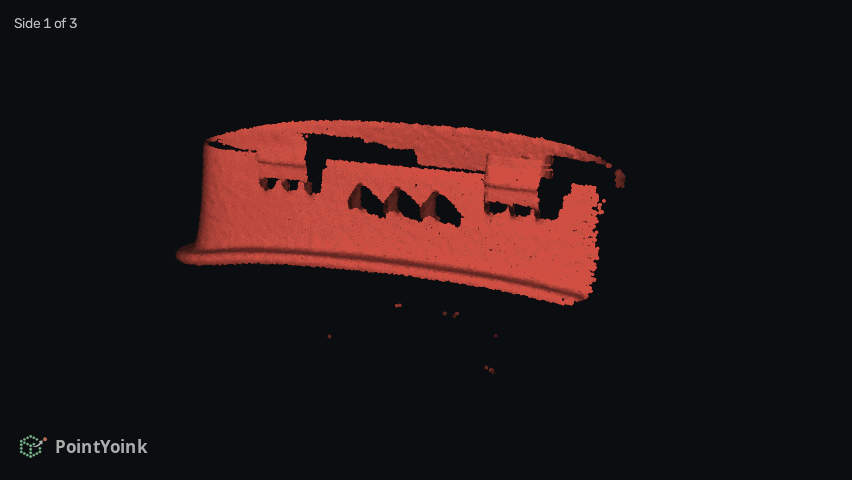

A saved scan replayed from its depth frames, about 3,900 of them. Red is surface that is barely seen, yellow is getting there, green is well covered, and covered surface settles to gray. Then the build's clean-up takes over and the finished model turns. This clip is 852 x 480 at 12 fps and 9.1 MB.

## Works with

MIRACO Pro (tested, this is the scanner it was built on) · MIRACO and MIRACO Plus (same design, should work, reports welcome).

More scanners can be added if I get hold of them to test.

## What you need

| | Minimum | Tested on |
|---|---|---|
| System | 64-bit Linux, Python 3.11 or newer | Ubuntu 24.04, Python 3.12 |
| Memory | 16 GB RAM (8 GB can run out on bigger scans) | 64 GB |
| Graphics | Any OpenGL 3.3 card for the 3D views | NVIDIA RTX 3080, 10 GB |
| Live scanning | An NVIDIA GPU with CUDA | RTX 3080 (CUDA), MIRACO Pro in PC mode |
| Disk | About 2.5 GB for the app's parts, plus about 1 GB per scanned side (a 12-side project with every recipe built took 22 GB) | NVMe SSD, 1.8 TB |

Without an NVIDIA card you can still import projects from the scanner, build, edit and export. Building runs on the CPU and takes longer. Live scanning in PC mode needs CUDA.

PointYoink runs each build step under a RAM and CPU limit through systemd, so a big build cannot freeze your desktop. On a system without a systemd user session, builds still run, without those limits, and the app says so.

## Install

### Debian / Ubuntu

Download the latest `.deb` from [Releases](https://github.com/datboip/point-yoink-v2/releases) and install it:

```bash
sudo apt install ./point-yoink_*_amd64.deb
```

Open **PointYoink** from your application menu, or run `point-yoink`. The first launch opens a setup window that lists each part 2.0 runs on (the Qt window, the Open3D 3D engine, the PyMeshLab mesh tools, OpenCV for the cameras), how big it is and why it is needed. Pick the NVIDIA or the CPU build of the engine, and it downloads them into a private folder (`~/.local/share/pointyoink` unless you press Change folder). Nothing big is installed system-wide. Run `point-yoink --setup` later to add or change parts.

### From source

```bash
sudo apt install python3-venv python3-tk jmtpfs rsync fuse3 v4l-utils
git clone https://github.com/datboip/point-yoink-v2
cd point-yoink-v2
python3 -m venv venv
./venv/bin/pip install -r packaging/requirements.txt
./venv/bin/python -m app2
```

No NVIDIA card: replace `open3d` with `open3d-cpu` in `packaging/requirements.txt` first. `ffmpeg` is optional; with it, timelapse export can also write MP4.

## What it does

The top ribbon follows the work: **Scan → Build → Edit → Export**. **Help → Getting started** in the app walks through it step by step, and the same guide is in [app2/GETTING_STARTED.md](app2/GETTING_STARTED.md).

### Projects

Open a saved project and continue where you left off.

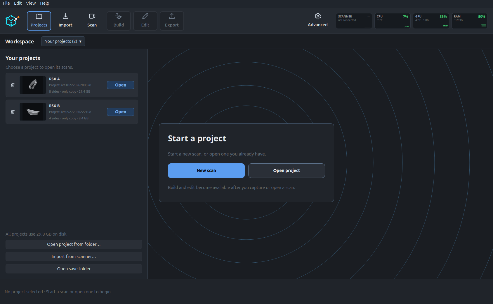

### Scan

Plug the MIRACO in over USB and pick **PC mode** on its screen. The live view shows the part filling in as you turn it. Scan one side, pause, flip the part, press **+ New side**, and keep going. Sides are lined up for you. Optional color capture uses the scanner's fill light.

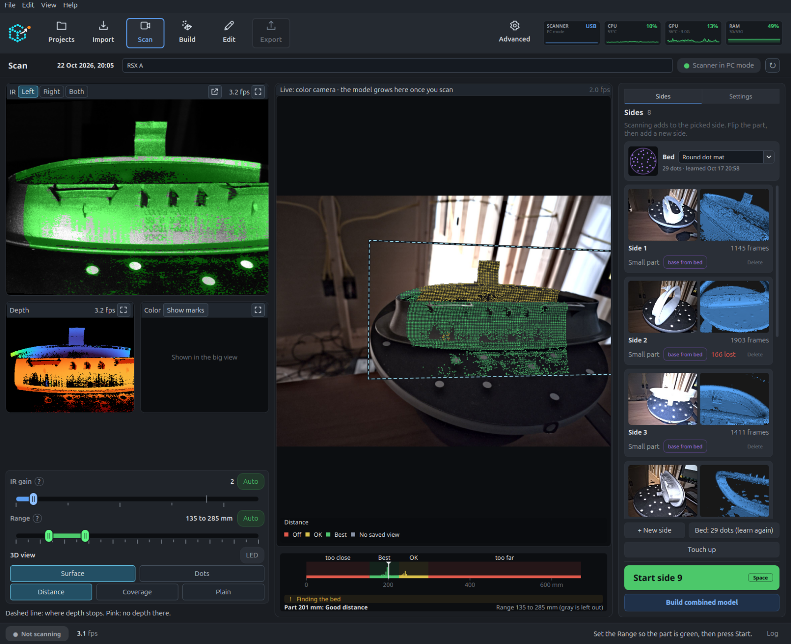

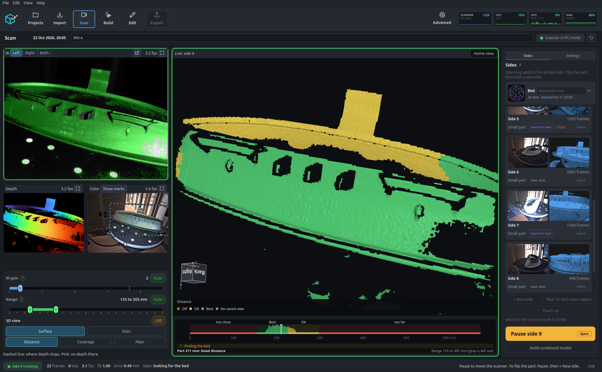

### Import

Already scanned on the scanner? Open **Import** and choose **USB File Transfer** or **Wi-Fi Share to PC** (type the code the app shows into the scanner). Each project shows its scans with their settings and a preview, and arrives with its raw frames, so it can be rebuilt here.

### Build

**Build** turns the frames into a model: each side is fused and its turntable cut away, the sides are lined up, joined and meshed. Each step is saved, so changing one setting only redoes what depends on it, and going back to an earlier setting is instant.

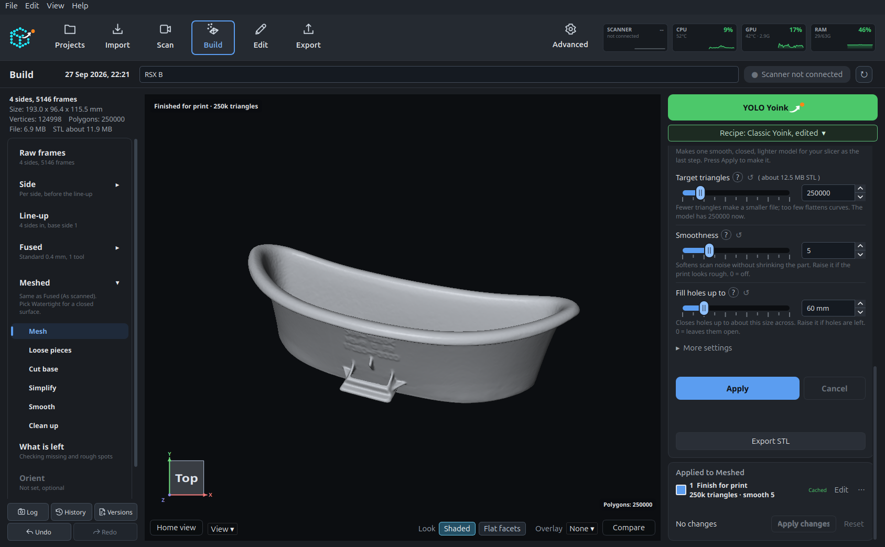

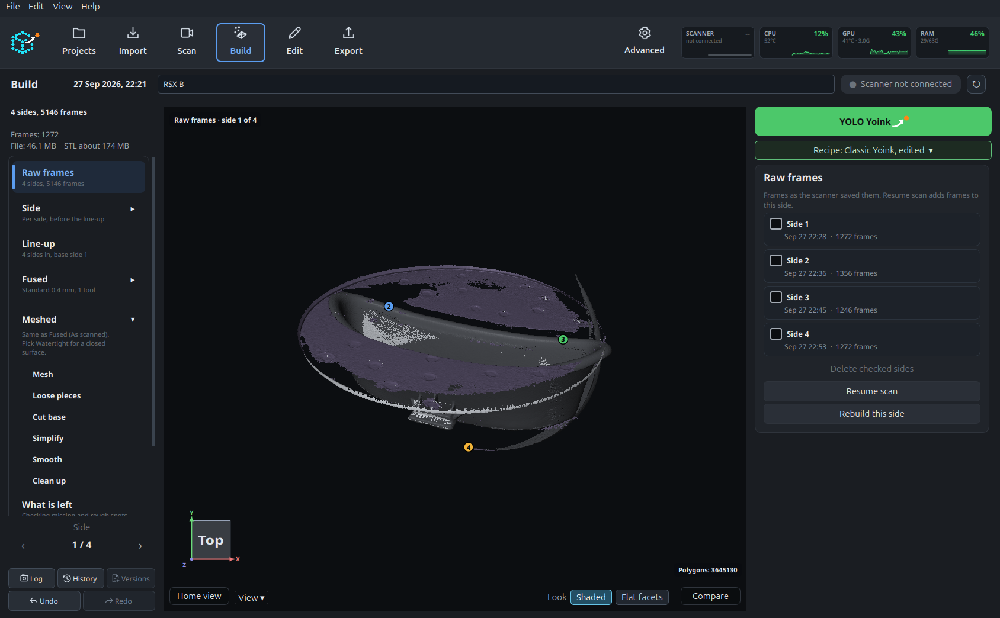


**YOLO Yoink** picks a recipe for you. The chip under it shows which recipe **Build** uses. Each recipe suits a different kind of part:

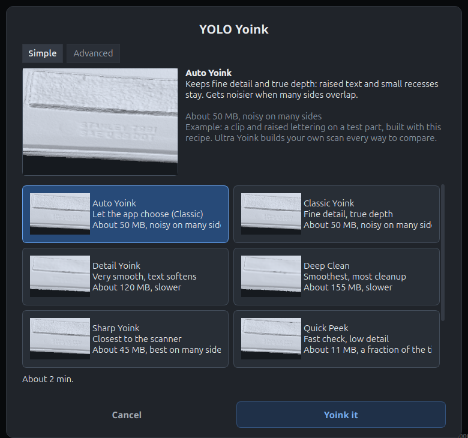

| Recipe | Good for |
|---|---|
| **Classic** | Keeps fine detail and true depth, like raised text |
| **Detail** | A very smooth new surface; fine text softens |
| **Deep Clean** | Like Detail with more clean-up; the biggest file |
| **Sharp** | Closest to the scanner's own model; smooth on many sides |
| **Quick Peek** | A fast check, low detail; can leave holes |
| **Print** | A small closed file ready to slice; fine text softens |

The **Advanced** tab sets the recipe's parts yourself: the build method, the detail size, how many loose pieces to remove, how many smoothing passes, and whether to finish for print after building. Name your settings and **Save preset** to reuse them.

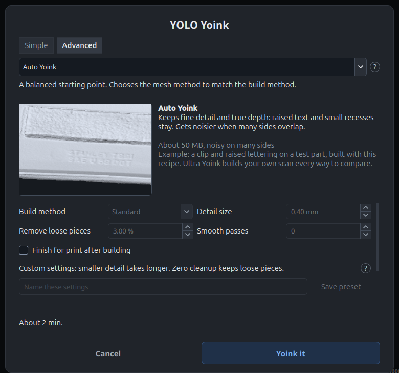

Not sure? **Ultra Yoink** builds several recipes one after another (it shows the time and disk space first), then lets you flip between the results.

### Edit

Select with rectangle, lasso, brush or a whole connected piece, and delete. Smooth, simplify, fill holes, cut a gap, cut a shape, or add a reinforcing fin. Every edit has a preview first, shows up in the stage's **Applied** list, and can be undone, turned off later, or compared with the model before it.

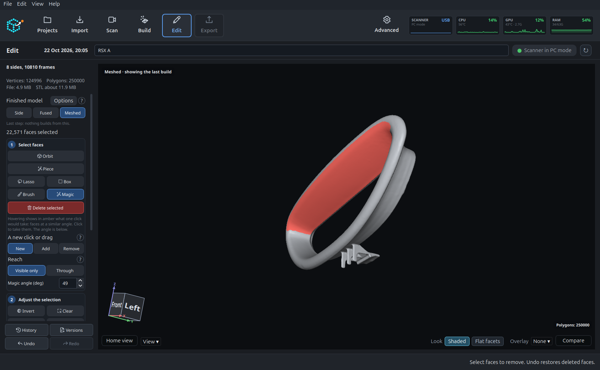

### Touch up and the scan guide

The Coverage view marks in red what was never scanned and in purple what came out rough. **Touch up** goes back to the scanner with those spots on screen and turns them green as you cover them. The scan guide suggests where to put the scanner, at what height and tilt, to reach what is left, including spots the part itself hides.

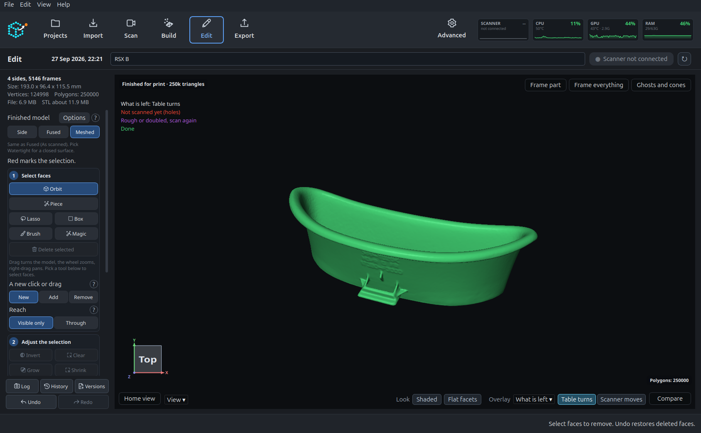

On this part nothing is left to cover, so it is all green. When something is, those spots show in red and purple on the model.

Live guidance needs a connected scanner.

### Export

Set which face sits on the bed and which way is front, then **File → Export STL** or 3MF. **Finish for print** reduces triangles, softens scan noise and closes small holes before you export.

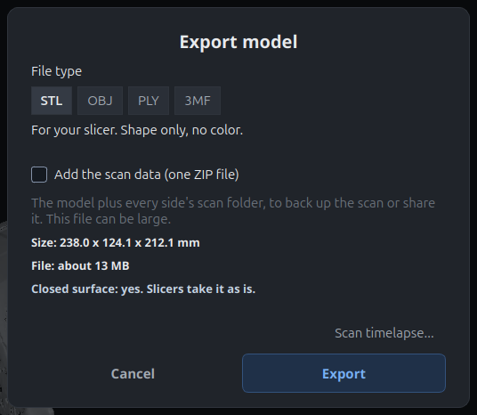

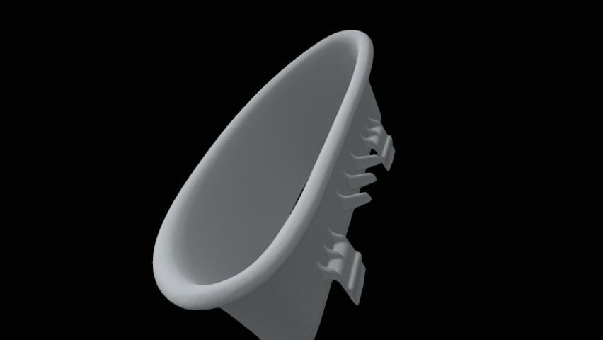

The finished-model orbit is 852 x 480 at 12 fps. These are saved-project examples. Live scanning and importing from a MIRACO still need a connected scanner.

## Details

<details>
<summary><b>How it works</b></summary>

A MIRACO scan is thousands of depth frames, each with a pose. Build fuses them per side in a TSDF volume ([Open3D](https://www.open3d.org/), on the GPU when there is one), cuts the turntable off, lines the sides up, joins them and meshes the result. Every step's result is stored under a key made from its inputs, settings and code, so nothing is rebuilt unless something it depends on changed. Heavy steps run as child processes, one at a time, under the RAM, CPU and GPU limits shown on the resource tiles at the bottom of the window (click a tile to see live use or set your own limits).

</details>

<details>
<summary><b>Where files go</b></summary>

Each project is a folder in your project library. `model.ply` is the finished model, `data/` holds the frames, and `stages/` holds the saved results of each build step.

</details>

<details>
<summary><b>Troubleshooting</b></summary>

- **Scanner not found for live scanning:** pick PC mode on the scanner's screen, then use a USB cable that carries data (some only charge).
- **Scanner not found for USB import:** tap File Transfer on the scanner. If the prompt does not appear, unplug, wait about ten seconds, and plug in again.
- **Wi-Fi import never starts:** the scanner and the PC must be on the same network.
- **"Live scanning needs an NVIDIA GPU":** this PC has no CUDA. Import and building still work.
- **A build stops with an out-of-memory note:** click the RAM tile and lower the limit, or close other heavy apps.
- **Anything else:** **Help → Report a problem**, then open an issue with it.

</details>

## Privacy

Everything happens on your machine, over USB or your local network. Nothing is uploaded anywhere.

## Contributing

Bug reports, test results and ideas are welcome, especially from MIRACO and MIRACO Plus owners and from PCs other than mine. See [CONTRIBUTING.md](CONTRIBUTING.md).

## License

GNU Affero General Public License v3.0 or later. See [LICENSE](LICENSE). You can use, change and share it; if you distribute it, or run a changed version as a service, you must share your source under the same license.

Questions about licensing: [@datboip on X](https://x.com/datboip).

## Credits

Full license notices are in [THIRD_PARTY_NOTICES.md](THIRD_PARTY_NOTICES.md).

Built with Qt (PySide6) for the window, Open3D for fusion and line-up, PyMeshLab for the mesh tools, OpenCV for the camera views, NumPy and SciPy, PyOpenGL for the 3D views, trimesh for export, and `jmtpfs` and `rsync` for USB transfer.
